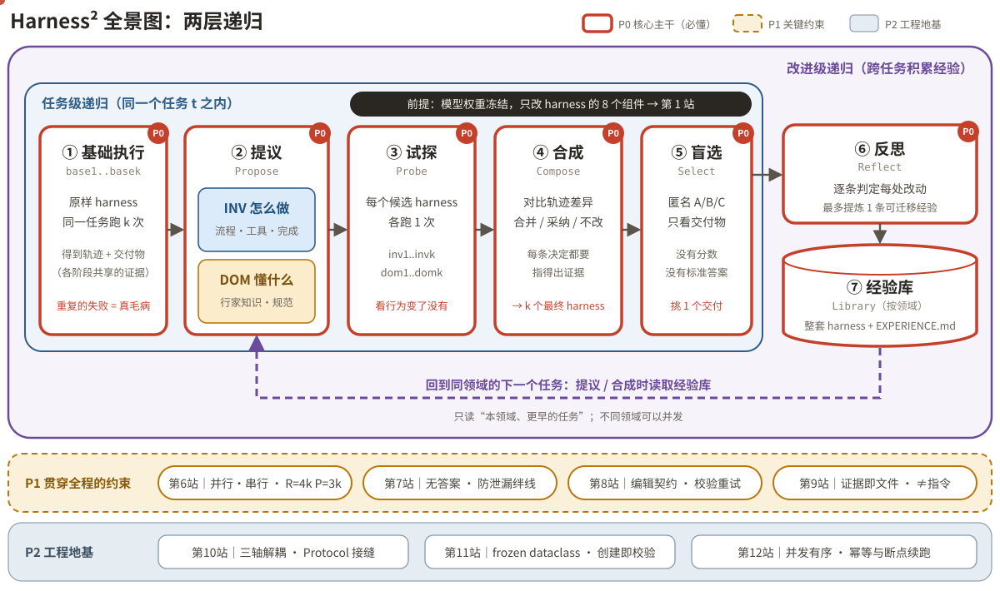
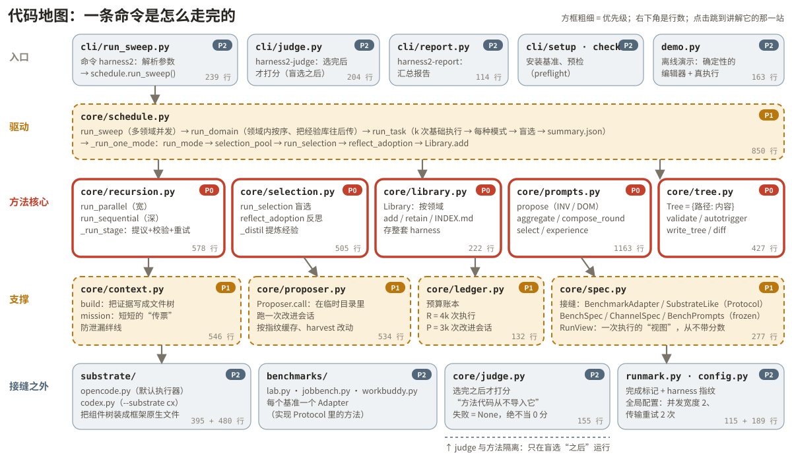

# 不换马，换马具：Harness² 中文图解教程

用 **12 则原创寓言 + 14 个动手演示 + 全中文图解**，带你读懂 Google Research 开源项目
[google-research/harness2](https://github.com/google-research/harness2) 的设计思想与代码实现。

> Harness²：模型权重一个都不改，只改它身上那套“马具”（harness）——提示词、护栏、技能、脚本、插件——
> 并且每做完一个任务，就把学到的经验带到下一个任务。

## 🚀 在线阅读（交互网页）

| 方式 | 地址 |
| --- | --- |
| GitHub Pages（推荐，需先开启，见下文） | https://dockcy.github.io/learn-harness2/ |
| 免配置预览 | https://htmlpreview.github.io/?https://github.com/dockcy/learn-harness2/blob/main/index.html |
| 纯文字版（GitHub 内直接看） | [docs/](docs/README.md) |

**开启 GitHub Pages**：仓库 **Settings → Pages → Build and deployment**，Source 选 *Deploy from a branch*，
Branch 选 `main`、目录 `/ (root)`，保存后约 1 分钟即可访问。整个网站是纯静态文件（一个 `index.html` + `assets/`），
也可以直接下载仓库、双击 `index.html` 本地打开。

## 🧭 怎么教：大纲 → 细节 + 寓言引导

1. **先看大纲**：序章用一张全景图把两层递归（任务级 / 改进级）画清楚，并用颜色标出优先级——
   红色粗框 = 必须先懂的主干（P0），琥珀虚线 = 关键约束（P1），石青细框 = 工程地基（P2）。
2. **再逐站拆细节**：每一站先讲一则**寓言**，故事里藏着一个设计难点或语法点；
   读者先猜，点“揭开谜底”后才出现概念名称，接着是 **故事 ↔ 代码对照表、中文流程图、带中文注释的源码节选、动手演示和小测验**。
3. 进度保存在浏览器本地；侧栏的谜底在揭晓前是模糊的，避免剧透。



## 🗺️ 学习路线

赶时间？只读 **P0 的五站**，就能讲清楚这个项目在做什么。

| 站 | 优先级 | 寓言 / 章节 | 对应源码（`harness2/` 下） |
| --- | --- | --- | --- |
| 序章 · 大纲 | ⚪ 导读 | [先看全景：一张图读懂 Harness²](docs/00-overview.md) | `core/schedule.py`、`core/recursion.py` |
| 第 1 站 | 🔴 P0 核心主干 | [《不能换马的驿站》](docs/01-harness.md) | `core/tree.py`、`substrate/opencode.py`、`substrate/codex.py` |
| 第 2 站 | 🔴 P0 核心主干 | [《没有考官的厨房》](docs/02-ppc.md) | `core/recursion.py`、`core/prompts.py` |
| 第 3 站 | 🔴 P0 核心主干 | [《钟楼的两把钥匙》](docs/03-inv-dom.md) | `core/prompts.py` |
| 第 4 站 | 🔴 P0 核心主干 | [《蒙眼品酒会》](docs/04-selection.md) | `core/selection.py`、`core/prompts.py` |
| 第 5 站 | 🔴 P0 核心主干 | [《老船长的航海日志》](docs/05-library.md) | `core/library.py`、`core/selection.py`、`core/schedule.py` |
| 第 6 站 | 🟠 P1 关键约束 | [《一样多的铲子》](docs/06-modes.md) | `core/recursion.py`、`core/ledger.py` |
| 第 7 站 | 🟠 P1 关键约束 | [《挂铃铛的丝线》](docs/07-answer-free.md) | `core/context.py`、`core/spec.py`、`core/judge.py`、`core/prompts.py` |
| 第 8 站 | 🟠 P1 关键约束 | [《只标改动的裁缝》](docs/08-validate.md) | `core/tree.py`、`core/recursion.py`、`core/prompts.py` |
| 第 9 站 | 🟠 P1 关键约束 | [《档案室里的那张纸条》](docs/09-context.md) | `core/context.py`、`core/prompts.py`、`core/proposer.py` |
| 第 10 站 | 🔵 P2 工程地基 | [《打更人的招募告示》](docs/10-protocol.md) | `core/spec.py`、`substrate/base.py`、`demo.py` |
| 第 11 站 | 🔵 P2 工程地基 | [《刻进石碑的章程》](docs/11-frozen.md) | `core/spec.py`、`core/tree.py`、`core/schedule.py` |
| 第 12 站 | 🔵 P2 工程地基 | [《同时出发的信使》](docs/12-concurrency.md) | `core/recursion.py`、`core/runmark.py`、`core/proposer.py`、`core/schedule.py` |
| 终点站 | ⚪ 导读 | [亲手跑一遍，再回头看全景](docs/13-final.md) | `demo.py`、`cli/demo.py` |

代码地图：每个源文件属于哪一层、对应哪一站。



## 🖐 14 个动手演示

组件探索器 · `_run_stage` 单步执行 · 合成器证据判断 · INV/DOM 分类 · 盲选字母分配（真实 `assign_ids` 算法）·
经验写法评判 · verdict 判定 · 预算账本模拟（含 `BudgetError`）· 防泄漏绊线试验台 ·
**校验器操练场**（用 JavaScript 复刻 `core/tree.py` 规则，错误信息与源码逐字一致）· 指令/证据辨析 ·
新基准适配器清单（Protocol 结构检查）· 冻结 dataclass 控制台 · 并发记账与断点续跑模拟。

## 🧪 亲手跑一遍原项目（无需模型密钥）

```bash
git clone https://github.com/google-research/harness2.git && cd harness2
uv venv --python 3.12 .venv && source .venv/bin/activate
uv pip install -e '.[render]'
harness2-demo --output runs/demo --k 2
```

本地演示用确定性的“假编辑器”代替大模型，但递归流程、经验库、盲选、预算账本和马具校验都是真代码。
终点站逐一解释输出目录和 `demo.json` 里的数字（`execution_count: 28`、`editor_calls: 32`）。

## 🛠️ 修改与构建本教程

```text
src/layout.html          页面骨架
src/chapters/*.html      每一站的正文（寓言 / 谜底 / 对照 / 源码 / 演示 / 小测）
assets/style.css         样式      assets/app.js   交互逻辑（无框架，代码高亮用 highlight.js CDN）
assets/img/*.svg         全中文手绘 SVG 图      tools/   生成代码地图、组件图等的脚本
build.py                 拼装 index.html，并生成 docs/*.md 纯文字版
```

```bash
pip install beautifulsoup4 markdownify   # 仅生成 docs/ 需要
python3 build.py                          # 生成 index.html 与 docs/
python3 tools/gen_readme.py               # 重新生成本 README
```

## 📜 说明

- 本教程对应源码版本：harness2 commit `1cfe254`。源码节选版权归 Google LLC 所有，遵循 Apache License 2.0。
- 寓言、讲解文字与全部图示为本教程原创。本仓库为个人学习资料，与 Google 无隶属关系。
- 发现错误或有更好的比喻？欢迎提 Issue / PR。
