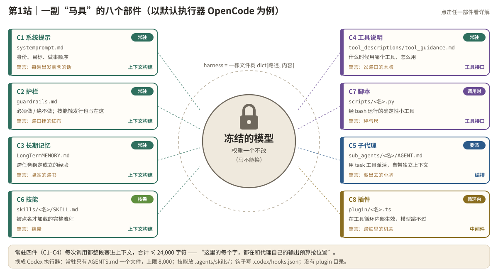

# 第 1 站｜不能换马的驿站

对应源码：[core/tree.py](https://github.com/google-research/harness2/blob/main/harness2/core/tree.py)、[substrate/opencode.py](https://github.com/google-research/harness2/blob/main/harness2/substrate/opencode.py)、[substrate/codex.py](https://github.com/google-research/harness2/blob/main/harness2/substrate/codex.py)

**【寓言】**

### 不能换马的驿站

西北有条走了几百年的驿道。驿道上有个死规矩：马是官马，一匹也不许换，连马吃的草料都不许动。

老周到最偏远的那座驿站当驿丞那年，正赶上驿道往外延伸：每个月都要派骑手去一条**从没人走过的新路**送信。路一条比一条怪，马还是那几匹马。前任驿丞跑得慢，被撤了，临走嘟囔了一句：“马就这样，有什么办法。”

老周不信这个邪。他围着马转了三天，在本子上列了张单子——马不能动，可马身上、马身边的东西，总能动吧？

他先改了骑手出发前要念的那段话：去哪、送什么、先走哪段后走哪段。又在几个出过事的路口挂上**红布**，红布底下写着“此处必须下马牵行”“此处绝不能抄近道”。他把历年骑手的心得抄成一本**路书**，只留每条路都用得上的那几条。岔路口立起**木牌**，写清哪条通水源、哪条通集镇。

有些本事不是每趟都用得上，比如怎么过流沙。老周把过流沙的法子写进一只**锦囊**，交代骑手：“看见流沙再拆。”货物要过秤，骑手以前全凭眼力估，老周就在鞍边挂了一杆**秤**和一把**尺**。要探路的时候，先放一匹**小驹**出去，它回来只带一句话：前面能不能走。

最后一样最费心思。有一段冰面，红布挂了，话也念了，骑手还是图快骑马冲过去，摔了两回。老周请铁匠在**马蹄铁里装了个机关**：一踩上冰，防滑钉自己弹出来。这一回，骑手想跳过也跳不过去。

当然也走过弯路。有一阵子路书越写越厚，骑手出发前光念就要念半个时辰，反倒误了行程，老周只好删掉一半。还有一只锦囊在箱底躺了半年，从没人拆过——没人知道有这只锦囊，有它和没它一个样。从那以后，老周每添一只锦囊，都要在红布上补一行：“遇到某某情况，拆某某锦囊。”

一年后，巡查的官员来了。驿站的马还是那几匹，新路上的信却快了一倍。官员绕着马看了半天，问：“你到底换了什么？”

老周拍了拍马背上那一整套家什，笑而不答。

先别往下翻，猜一猜：老周拍着的那一整套“家什”，在今天的 AI 代理里叫什么？马、骑手、新路又分别是什么？

> 🤔 先停一停：这个故事讲的是 Harness² 的哪个设计？想好了再往下读。

---

**【谜底揭晓】**

#### 谜底：Harness ——“马具”

英文 **harness** 的本义就是**马具**。在 AI 代理里，它指包在**冻结的大模型**外面、决定模型“怎么干活”的那一整套可编辑部件：提示词、护栏、记忆、工具说明、子代理、技能、脚本、插件。Harness² 不训练模型、不改一个权重，**只改马具**。

### 故事 ↔ 代码对照

| 故事里 | Harness² 里 |
| --- | --- |
| 不许换的官马 | 冻结的模型（权重固定，model weights fixed） |
| 每月一条没走过的新路 | 设计 harness 时没见过的新任务（项目标题里的 open world） |
| 出发前念的话 | C1 系统提示 `systemprompt.md` |
| 路口的红布 | C2 护栏 `guardrails.md` |
| 路书（只留通用的几条） | C3 长期记忆 `LongTermMEMORY.md` |
| 岔路口的木牌 | C4 工具说明 `tool_descriptions/tool_guidance.md` |
| 先放出去探路的小驹 | C5 子代理 `sub_agents/<名>/AGENT.md` |
| 看见流沙再拆的锦囊 | C6 技能 `skills/<名>/SKILL.md` |
| 秤和尺 | C7 脚本 `scripts/<名>.py` |
| 蹄铁里的机关 | C8 插件 `plugin/<名>.ts` |
| 路书太厚，误了行程 | 常驻内容有总长上限（OpenCode 为 24,000 字符） |
| 箱底没人拆的锦囊 | 没被点名的技能是“死重”（dead weight），校验会报错 |
| 红布上补一行“遇到…拆…” | 技能触发行；代码会自动补（`autotrigger`，第 8 站细讲） |



*图：八个组件围绕冻结的模型。颜色表示运行时角色，右上角徽章表示“什么时候生效”。点击任一部件。*

> 🖐 动手演示「组件探索器」：请打开网页版体验。

### 四种运行时角色：从“说”到“做”

项目 README 把八个组件按**运行时角色**分成四组。理解这四组的关键，是看它们离“模型自己决定”有多远：

| 角色 | 组件 | 怎么影响代理 | 代价与力度 |
| --- | --- | --- | --- |
| 上下文构建 | C1 C2 C3 C6 | 往模型的上下文里放文字 | 最便宜；但模型可以“读了不照做” |
| 工具接口 | C4 C7 | 告诉它怎么用工具 / 给它确定性的新工具 | 把容易算错的步骤交给代码 |
| 编排 | C5 | 把一段活派给有独立上下文的子代理 | 省主上下文，但多一次调用 |
| 中间件 | C8 | 在工具循环**内部**拦截、改写 | 唯一“模型跳不过”的杠杆；也最容易误伤 |

**设计要点：用“最便宜的有效部件”**项目给编辑器的提示词里反复强调：把每个失败对应到**最便宜、但足够有效的部件**。普通的先后顺序问题，写一句常驻提示就够；重复的机械劳动才写脚本；只有反复证明“写清楚了也会被跳过”的硬规矩，才动用插件。老周也是先挂红布，摔了两回才去改蹄铁。（第 3 站会细讲这套对应关系。）

### 在代码里，harness 就是一个字典

整个项目里，一棵 harness 的类型只有一行：

📄 harness2/core/tree.py（节选）

```python
Tree = dict[str, str]   # 一棵 harness = {相对路径: 文件内容}，就这么简单
```

不同执行器（OpenCode、Codex）允许编辑哪些路径、有哪些限制，写在一个叫 `SurfaceSpec`（可编辑表面）的冻结数据类里。下面是默认执行器 OpenCode 的那一份：

📄 harness2/substrate/opencode.py（节选，中文注释为本教程所加）

```python
OPENCODE_SURFACE = SurfaceSpec(
    name="opencode",
    always_on=(                                   # 常驻：每次调用都整段放进上下文
        "systemprompt.md",                        # C1 系统提示
        "guardrails.md",                          # C2 护栏
        "LongTermMEMORY.md",                      # C3 长期记忆
        "tool_descriptions/tool_guidance.md",     # C4 工具说明
    ),
    always_on_max=24_000,                         # 常驻内容合计上限（字符数）
    always_on_cap_reason="every token here competes with the agent's own output budget",
    skill_dir="skills",                           # C6 技能：skills/<名>/SKILL.md
    skill_name_rule="must_match",                 # frontmatter 的 name 必须等于目录名
    autotrigger_file="guardrails.md",             # 自动补触发行时写进这个文件
    trigger_line="- When {desc}, load the `{name}` skill.\n",
    subagent_requires_mode=True,                  # C5 子代理必须声明 mode: subagent
    plugin_dir="plugin",                          # C8 插件：plugin/<名>.ts
    hooks_file=None,                              # OpenCode 没有 hooks 文件
    # ……其余字段省略
)
```

上限的理由写得很直白：“*这里的每一个 token，都在和代理自己的输出预算竞争*”——就是老周那本越写越厚的路书。

路径也有严格规矩。组件名只能用小写字母、数字、`_` 和 `-`；任何想“逃出” harness 目录的路径直接拒绝：

📄 harness2/core/tree.py（节选）

```python
_NAME = r"[a-z0-9][a-z0-9_\-]*"          # 组件名：小写字母或数字开头

def normalize_rel(rel: str) -> str:
    """规范化相对路径，在拼到目录上之前拒绝越界。"""
    r = str(rel).strip().replace("\\", "/")
    if r.startswith("/") or ".." in r.split("/"):
        raise ValueError(f"path escapes the harness: {rel!r}")   # 绝对路径、.. 一律拒绝
    ...

def is_allowed(surface: SurfaceSpec, rel: str) -> bool:
    """这个路径在不在可编辑表面上。是个判断函数：从不抛异常。"""
```

### 换一个执行器，表面就换一套

|  | OpenCode（默认） | Codex（`--substrate cx`） |
| --- | --- | --- |
| 常驻文件 | C1–C4 四个文件 | 只有 `AGENTS.md` 一个 |
| 常驻上限 | 24,000 字符 | 8,000 字符；空文件直接拒绝（“空的 AGENTS.md 等于没有 harness”） |
| 技能目录 | `skills/`，name 必须等于目录名 | `.agents/skills/`，name 会**覆盖**目录名 |
| 循环内杠杆 | `plugin/<名>.ts` | 没有插件目录，用 `.codex/hooks.json` 钩子 |

**教学解读：为什么把 harness 设计成“路径→内容”的纯字典？**① 不用跑就能**比较**（diff 出改了哪几个文件）、**校验**（第 8 站）、**存档**（第 5 站整棵存进经验库）；② 方法代码对执行器一无所知，换执行器只换一份 `SurfaceSpec`（第 10 站）；③ 编辑器改的就是普通文本文件，人也能直接审阅。

**小测：**某个检查步骤，常驻提示里已经写得清清楚楚，可执行记录显示代理**反复**跳过它。按项目的思路，最后该动用哪个部件？

- A. 再在系统提示里加粗、加三个感叹号
- B. 写进长期记忆，让它每次都看到
- C. 插件：在工具循环内部强制执行
- D. 写一个技能，等它自己想起来调用

<details><summary>看答案</summary>

**答案：C**　插件（OpenCode 的 C8）作用在工具循环内部，是“唯一能强制执行模型跳不过的事”的杠杆。但项目同样要求：只有**反复**证据表明清楚的文字会被跳过时才这样做，而且不能挡住正常的完成——就像老周摔了两回才去改蹄铁。

</details>

**小测：**在 OpenCode 表面上，下面哪个路径会被判为“越界”（不在可编辑表面上）？

- A. skills/doc\_review/SKILL.md
- B. scripts/check\_totals.py
- C. skills/DocReview/SKILL.md
- D. plugin/guard.ts

<details><summary>看答案</summary>

**答案：C**　组件名必须匹配 `[a-z0-9][a-z0-9_\-]*`，大写字母不行。编辑器交回这种文件时，会收到“这些文件不在可编辑表面上，未被采用”的反馈，并被要求改名重交。

</details>

**本站带走三句话**

- Harness = 冻结模型之外一切可编辑的部件；Harness² 只改它，不改权重。
- 八个组件分四种角色；越靠近“机制”越难被跳过，也越贵、越容易误伤——优先用最便宜的有效部件。
- 代码里一棵 harness 就是 `dict[str, str]`；每个执行器的规矩写在一份 `SurfaceSpec` 里。
