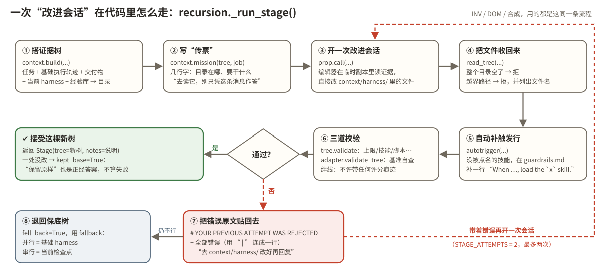

# 第 2 站｜没有考官的厨房

对应源码：[core/recursion.py](https://github.com/google-research/harness2/blob/main/harness2/core/recursion.py)、[core/prompts.py](https://github.com/google-research/harness2/blob/main/harness2/core/prompts.py)

**【寓言】**

### 没有考官的厨房

老秦的小馆有条怪规矩：每天只接一位客人，客人点的一定是店里**从没做过的菜**，要求只有一两句话。没有美食评论家，没有标准菜谱，客人吃完就走，从不打分。

掌勺的还是那位厨子，手艺改不了。老秦能改的，只有挂在灶台边那一叠“做菜规矩”。

新菜来了，老秦不急着改规矩。他先让厨子**照老规矩做两锅**，自己站在边上看——不尝味道，只记过程：几时下油、几时翻锅、哪一步手忙脚乱。两锅都在同一步粘了锅。老秦在本子上写：“两锅都粘，是规矩的毛病。”有一锅盐放多了，他想了想，没写：“一锅的事，兴许是手抖。为它改规矩，是冤枉规矩。”

接着，他叫来两个徒弟，让他们对着这两锅的记录，**各自提一版新规矩**。大徒弟盯的是“手上怎么做”，二徒弟盯的是“这道菜在行家眼里该是什么样”。

“光说不算数。”老秦让厨子照每一版新规矩**真做一锅**。

四锅做完，老秦把四份过程记录摊在桌上对照。大徒弟那版写了“油热后先离火三秒再下料”，那一锅在老地方果然没粘——这条留下，旁边注明：“老规矩两锅都在这一步粘锅，新规矩这锅在这一步没粘。”二徒弟那版添了一勺糖，可那一锅从头到尾看不出糖起了什么作用——删掉。还有一条“收汁要收到挂勺”，照着做的那锅直接烧糊，什么也没端出来——“端不出菜的改法，说得再好听也不能要。”

最后老秦只合成了**一版**规矩，挂回灶台。

徒弟问：“师父，要是哪一版都不比老规矩强呢？”老秦说：“那就留着老规矩，这也是答案。白加的规矩，占地方，还碍事。”

徒弟又问：“没人打分，您怎么知道哪条改对了？”老秦敲了敲那叠记录：

“每一处改动，都要指得出是哪一锅、哪一刻。指不出来的，就是猜。”

猜一猜：老秦这套“先照常做几锅 → 各提一版改法 → 每版真做一锅 → 对照过程合成一版”的功夫，在 Harness² 里叫什么？

> 🤔 先停一停：这个故事讲的是 Harness² 的哪个设计？想好了再往下读。

---

**【谜底揭晓】**

#### 谜底：提议—试探—合成（Propose–Probe–Compose）

这是 Harness² **任务级递归**的一步：**提议**（Propose）几版 harness 修改 → 每版在同一个任务上真跑一次做**试探**（Probe）→ 根据执行之间的**行为对比**，**合成**（Compose）出一版最终 harness。全程**没有标准答案、没有评分**——信号只来自“同一个任务，不同 harness，过程有什么不同”。

### 故事 ↔ 代码对照

| 故事里 | Harness² 里 |
| --- | --- |
| 每天一道没做过的菜 | 一个新任务（task） |
| 没有评论家、不打分 | 没有标准答案（without ground-truth feedback） |
| 照老规矩先做两锅 | 基础执行（base rollouts）：原样 harness 跑 k 次，这里 k=2 |
| 不尝味道，只记过程 | 读执行轨迹（trajectory）：每一步动作、观察、报错 |
| 两个徒弟各提一版 | 提议：INV 编辑器和 DOM 编辑器各出一版候选（第 3 站） |
| 每版真做一锅 | 试探：每个候选 harness 在同一任务上执行一次 |
| 摊开四份记录，合成一版 | 合成：合成器（aggregator）读全部证据，产出一棵最终 harness |
| 两锅都粘 = 毛病；一锅盐多 = 手抖 | 基础执行里反复出现的失败才是真问题；1/k 的缺陷是噪声 |
| 端不出菜的改法不能要 | 关联执行“什么都没交付”的改动视为 UNSAFE |
| 留着老规矩也是答案 | `KEEP_BASE`：“是正经答案，不是失败” |
| 指得出哪一锅、哪一刻 | 每条决定都要引用具体轨迹时刻，否则就是猜测 |

### 三个动作，各管什么

**提议 Propose**编辑器读基础执行的证据，直接改一份 harness 副本。并行模式一次出 2k 版（k 个 INV + k 个 DOM）。

→

**试探 Probe**每个候选 harness 在**同一个任务**上真跑一次，得到它自己的轨迹和交付物。

→

**合成 Compose**合成器同时看基础执行和所有候选的执行，合并、整版采纳或保持原样，交出一棵树。

注意“试探”这一步的意义：编辑器提出的每条改动只是一个**假设**；只有真跑一次，才能在轨迹里看到它有没有改变行为。合成器做决定靠的就是这些**行为对比**，而不是改动“听起来多有道理”。

### 代码里：每一次“提议”或“合成”都走同一条流程

不管是 INV 提议、DOM 提议，还是合成，在代码里都是调用同一个函数 `recursion._run_stage()`，只是传进去的“任务说明”（job）不同。用下面的步进器走一遍：



*图：一次改进会话的流程。失败的提议会带着错误原文重来一次；两次都不行就退回保底树。*

> 🖐 动手演示「单步走一遍 \_run\_stage」：请打开网页版体验。

📄 harness2/core/recursion.py · \_run\_stage（节选，中文注释为本教程所加）

```python
for attempt in range(1, STAGE_ATTEMPTS + 1):          # STAGE_ATTEMPTS = 2：最多两次
    reply = prop.call(
        mission
        + (f"\n\n# YOUR PREVIOUS ATTEMPT WAS REJECTED\n\n{err}\n\n"   # 上一次的错误原文
           f"Fix it in `context/harness/` and reply again." if err else ""),
        tree.root,
        f"{label}.a{attempt}",
        harvest="context/harness",        # 会话结束后，把这个目录收回来
        max_attempts=TRANSPORT_ATTEMPTS,
    )
    ...
    new = harness_tree.read_tree(surface, reply.workspace, rejected=rejected)
    if not new:                           # 整个目录被删空：拒绝
        err = "`context/harness/` came back empty -- edit the files, do not delete them all"
        continue
    if rejected:                          # 有越界文件：列出来，要求重交
        err = "these files are off the editable surface and were not applied: " + ...
        continue
    kept, err = _accept_tree(surface, adapter, new, fallback, label)   # 补触发 + 三道校验
    if err:
        continue                          # 带着错误再来一次
    return Stage(label=label, dim=dim, tree=new, kept_base=kept, ...)

return Stage(label=label, dim=dim, tree=dict(fallback), fell_back=True, error=err[:400], ...)
#      ↑ 两次都失败：退回保底树，并把错误记下来
```

**一个细节：`kept_base` 不是失败**`_accept_tree` 会先 diff 新树和保底树：如果一个文件都没增、删、改，就记 `kept_base=True`。这对应提示词里那句 “KEEP\_BASE is a real answer, not a failure. Adaptation that the evidence does not argue for is a regression: it costs context and buys nothing.”——没有证据支持的改动本身就是退步：占上下文，换不来任何东西。

### 合成器手里的“称重规则”

合成是整个方法里最需要判断力的一步。项目给合成器的提示词（`prompts.aggregate`）开宗明义：*你交出的东西就是被采纳的东西……你是最后一道关，合并一条改动就等于替它“洗白”*（you are the last gate, and merging an edit launders it）。下面是它的称重规则：

| 规则（中文意译） | 原文要点 |
| --- | --- |
| k 次基础执行来自**同一个分布**，要当成一组看，而不是 k 个独立故事 | draws from ONE distribution -- read them as a set |
| 在基础执行里**反复出现**的失败是真问题，是最有力的依据；只出现 1/k 次的是噪声，针对它改就是对单个样本过拟合 | A defect in 1/k is noise, and an edit aimed at it is overfitting to one sample. |
| 每个候选只跑了一次，单次好坏都是弱证据；改动要靠轨迹里**某个具体时刻**显示出作用机制才算数 | 'this looks like good practice' is not evidence; name the moment. |
| 下行风险和上行收益同等看重；关联执行**什么都没交付**的改动，视为不安全 | treat that edit as UNSAFE |
| 候选之间意见一致，只是**支持**，不是独立证明（它们共享任务、证据和模型偏见）；意见矛盾就去读轨迹，而不是投票 | Agreement is support, not independent proof; contradiction is a reason to inspect the trajectories, not to vote. |
| 三种都是合法结果：跨候选**合并**（INV 和 DOM 各有贡献时最常见）、**整版采纳**一个、**保持原样** | MERGE / ADOPT ONE WHOLESALE / KEEP\_BASE |

每条决定都要按固定格式写进 `<notes>`，例如：

```tree
kept    -> inv1: 写完后重新打开文件核对   -> failed in 2/3 base rollouts；inv1 在第 41 步重开文件并修正错列
dropped -> dom2: “保持专业、认真负责”       -> 与基础执行相比没有任何可观察的行为差异
dropped -> dom1: 收汁式的强制格式检查       -> dom1 的执行什么都没交付，UNSAFE
```

（上面三行是本教程编的示例，格式与提示词要求一致：`kept|revised|dropped -> 哪条改动 -> 决定它的轨迹时刻或基础执行规律，涉及集合时写出计数`。提示词的解释是：“A decision without evidence attached is a decision the next reader cannot audit.”）

> 🖐 动手演示「站得住还是站不住？」：请打开网页版体验。

**小测：**k=3 时，有个缺陷只在 1 次基础执行里出现。为什么合成器不该专门为它改 harness？

- A. 因为这个缺陷不重要
- B. 三次基础执行来自同一分布，1/3 的缺陷更可能是噪声，针对它改就是对单个样本过拟合
- C. 因为预算不够，只能改最大的问题
- D. 因为基础执行的轨迹不可信

<details><summary>看答案</summary>

**答案：B**　就像老秦说的“一锅的事，兴许是手抖”。反复出现的失败才是 harness 的真实属性，也是最值得动手的依据。

</details>

**本站带走三句话**

- 提议—试探—合成：改动先是假设，真跑一次才有证据，合成只认**行为对比**。
- 所有改进会话都走 `_run_stage`：搭证据 → 开会话 → 收文件 → 校验 → 失败带着错误原文重试一次 → 再失败退回保底树。
- “保持原样”是正经答案；每条决定都要指得出“哪一锅、哪一刻”。
