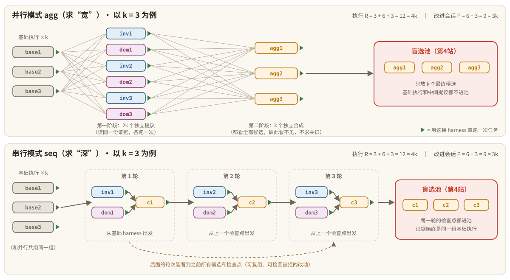

# 第 6 站｜一样多的铲子

对应源码：[core/recursion.py](https://github.com/google-research/harness2/blob/main/harness2/core/recursion.py)、[core/ledger.py](https://github.com/google-research/harness2/blob/main/harness2/core/ledger.py)

**【寓言】**

### 一样多的铲子

山里发现了矿脉，矿主请来两支勘探队，规矩是：**两队领到的铲子工一样多，开会的次数也一样多**，看谁找的矿址好。两队用的是同一份老勘测图——那是矿主先派人照老法子挖的几个坑。

**东队铺得开。**队长让人对着老勘测图，同时在六个不同的地方各挖一个试坑。挖完，他把三个工头分开关进三间屋子，每人都拿到全部六个试坑的记录，各自画一张主矿井的选址图。“别互相打听，别想着凑一个大家都同意的方案，画你自己能讲出道理的那张。”

**西队挖得深。**队长先挖两个试坑，选出一个落脚点；第二轮从这个落脚点出发再挖两个，再选落脚点；第三轮如此。每一轮都可以回头翻前面所有试坑的记录——发现前面放弃的某个坑其实不错，可以捡回来；发现后两轮越挖越偏，也可以退回到第一轮的落脚点。

账房先生两边跑，挖一个坑记一笔，开一次会记一笔。月底一对账：两队挖坑数一样，开会数也一样，一笔不差。

账房先生对账时有个怪习惯：**先查编号有没有重复，再数总数**。徒弟不解。他说：“两个坑刷了同一个编号，说明后挖的那个把先挖的记录盖掉了。总数就算对得上，也有一个坑是从来没真挖过的。”

东队交上来三张选址图，西队交上来三个落脚点，都交给第 4 站那种蒙眼的评选。至于哪队更好？矿主说：“看山。有的山要多看几处才不漏，有的山得一层层往下钻才见底。”

猜一猜：东队和西队，分别对应 Harness² 的哪两种模式？账房先生的“一笔不差”又是什么？

> 🤔 先停一停：这个故事讲的是 Harness² 的哪个设计？想好了再往下读。

---

**【谜底揭晓】**

#### 谜底：并行递归（宽）与串行递归（深），预算恒等式 R = 4k、P = 3k

**并行模式**（磁盘上记作 `agg`）：同一份证据上一次出 2k 个独立候选，再由 k 个**互不相见**的合成器各合成一版。**串行模式**（`seq`）：k 轮嵌套，每轮从上一轮的检查点出发，提议两版、合成一个新检查点。两种模式在同一个 k 下花的预算**完全相同**：执行 R = 4k 次，改进会话 P = 3k 次，由账本 `Ledger` 逐笔记录、最后核对。

### 故事 ↔ 代码对照

| 故事里 | Harness² 里 |
| --- | --- |
| 同一份老勘测图 | 两种模式**共用**同一组 k 次基础执行（只跑一次，两本账各记一遍） |
| 东队：六个试坑同时挖 | 并行：`inv1..invk`、`dom1..domk` 共 2k 个候选，各跑一次 |
| 三个工头分屋画图，不凑共识 | k 个合成器 `agg1..aggk`：都看全部候选，彼此看不见。“Do not aim for the consensus answer -- commit to the harness you can defend.” |
| 西队：每轮两个坑，选落脚点 | 串行：第 t 轮 `inv_t`、`dom_t` → 合成检查点 `c_t` |
| 可以捡回放弃的坑、退回早先的落脚点 | 合成提示词允许“合并之前被拒的候选”“原样复现更早的检查点” |
| 挖坑数、开会数一笔不差 | `Ledger.assert_identity()`：R = 4k，P = 3k |
| 先查编号重复，再数总数 | 先查重复标签：重复意味着一个运行目录覆盖了另一个 |



*图：并行（上）与串行（下）对照，以 k = 3 为例。绿色三角 = 用这棵 harness 真跑一次任务。*

### 预算为什么恰好是 4k 和 3k？

|  | 执行（R，rollout） | 改进会话（P，session） |
| --- | --- | --- |
| 基础执行 | k（两模式共用，各记一遍） | — |
| 候选 | 2k（每个 INV / DOM 候选跑一次） | 2k（k 个 INV + k 个 DOM） |
| 最终 / 检查点 | k（每个 agg 或 c 跑一次） | k（k 次合成） |
| **合计** | **4k** | **3k** |

盲选和反思**不**记在这本账里。同一次会话的重试也不额外算一次 P，而是记在该条目的 `attempts` 字段里。这样两种模式的比较才公平：差别只在“怎么花”，不在“花多少”。

> 🖐 动手演示「预算模拟器」：请打开网页版体验。

### 两种模式的关键差别

|  | 并行 agg（宽） | 串行 seq（深） |
| --- | --- | --- |
| 候选从哪出发 | 都从基础 harness 出发 | 第 t 轮从检查点 `c(t-1)` 出发（第 1 轮从基础 harness） |
| 证据 | 基础执行 | 始终是同一组基础执行 + 之前所有轮次的候选与检查点 |
| 合成器 | k 个，同时、独立 | 每轮 1 个，依次 |
| 失败时的保底树 | 基础 harness | 当前检查点 |
| `KEEP_BASE` 的含义 | 保持基础 harness | 保持**当前检查点** |
| 擅长 | 多样性：多看几处，不漏好方向 | 深度：在好方向上一层层打磨 |

并行模式还有个防“扎堆”的小工具：`tree.diversity()` 计算候选两两之间的行级 Jaccard 相似度，如果所有候选塌缩成同一个版本，一眼就能看出来。

📄 harness2/core/ledger.py（节选，中文注释为本教程所加）

```python
def expected_rollouts(k: int) -> int:
    """R = 4k：k 次共用的基础执行 + 2k 个候选 + k 个最终版。"""
    return 4 * int(k)

def expected_sessions(k: int) -> int:
    """P = 3k：k 个 INV + k 个 DOM + k 次合成（并行 agg1..aggk；串行 c1..ck）。"""
    return 3 * int(k)

def assert_identity(self) -> None:
    """除非账本恰好是 R=4k、P=3k 且没有重复标签，否则抛错。
    先查重复、再数总数——因为重复的条目也可能把总数凑对。"""
    want_r, want_p = expected_rollouts(self.k), expected_sessions(self.k)
    rl, sl = self.labels("rollout"), self.labels("session")
    dupes = sorted({l for l in rl if rl.count(l) > 1} | {l for l in sl if sl.count(l) > 1})
    if not dupes and self.R == want_r and self.P == want_p:
        return
    ...  # 拼出详细报告：“重复标签说明两个阶段写了同一个运行 id，一个悄悄覆盖了另一个，
         #   账本里算了的某个候选其实从未真正产生”
    raise BudgetError("\n".join(detail))
```

**设计要点：用“恒等式”守住公平**研究代码最怕“看起来跑完了，其实少跑了一个”。账本不只是记账，它在每个模式结束时断言恒等式成立，而且故意**先查重复**：如果 `inv1` 被记了两次、`dom1` 一次没记，总数照样对得上——只有查重复才能抓住这种静默覆盖。

**小测：**k = 2 时，一个任务跑完两种模式，实际一共执行了多少次任务（不含盲选和反思）？

- A. 16 次：每种模式 R = 4k = 8
- B. 14 次：基础执行 2 次共用，每种模式再各跑 6 次
- C. 12 次：P = 3k = 6，两种模式共 12
- D. 8 次

<details><summary>看答案</summary>

**答案：B**　每本账各记 R = 8，但其中 2 次基础执行是共用的，只真跑一次：2 + 6 + 6 = 14。本地 demo 跑两个任务，执行计数正好是 28 = 2 × 14。

</details>

**本站带走三句话**

- 并行求宽：2k 个独立候选 + k 个互不相见的合成；串行求深：k 轮“提议两版 → 合成检查点”。
- 同一个 k，两种模式预算完全相同：R = 4k，P = 3k；盲选、反思不入账。
- 账本先查重复、再核总数，防止静默覆盖。
